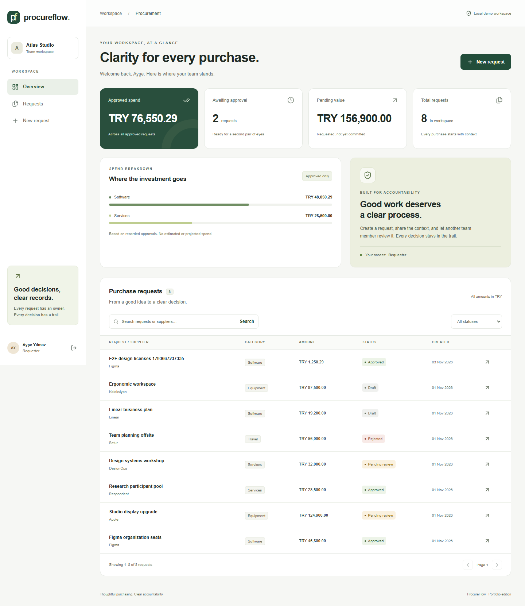

# ProcureFlow

A procurement approval workspace built with **Next.js 16, React 19 and strict TypeScript**. Requesters explain a purchase, another team member reviews it, and an atomic audit trail records every decision.

## Run locally

Requires Node.js 22.13+ and npm. No external accounts or database server.

1. Run `npm ci`.
2. Copy `.env.example` to `.env.local`. Set a unique `DEMO_PASSWORD` of at least 12 characters; keep `DEMO_MODE=true` and `APP_ORIGIN=http://127.0.0.1:3000`.
3. Run `npm run dev` and open [the local workspace](http://127.0.0.1:3000).
4. Choose Ayşe (requester), Mert (approver), Deniz (viewer), or Elif (a separate company). Use your configured password. Data seeds once in the local SQLite file.

For the packaged build: `npm run build`, then `npm start`. The startup wrapper preserves the database location used by development. `npm run db:seed` optionally initializes the same database. Do not commit local environment files or data.

## What works

- Server-rendered workspace with derived spend metrics and category chart.
- Search, status filter, pagination, typed REST integration and query cache.
- Accessible validated forms, integer monetary values, draft → review → approval/rejection.
- Server-enforced roles, ownership, self-approval prevention and tenant isolation.
- Opaque expiring sessions, logout revocation, origin checks and body limits.
- SQLite transactions, optimistic revisions and atomic audit history.
- Responsive mobile layout, error/empty/loading states and keyboard navigation.

## Engineering

Feature-oriented layers: domain policies → application ports/use cases → infrastructure adapters; Next routes and components compose them. Interfaces are small, and policy tests do not need Next.js or a database. Read the [architecture and SOLID mapping](docs/architecture.md), [decisions](docs/decisions.md), [API contract](docs/api.md), [security boundaries](docs/security.md) and [validation record](docs/validation.md).

The [LinkedIn Türkiye report](docs/research/linkedin-turkiye-2026-11-03.md) contains exact source URLs, per-posting coding, required/preferred distinctions and project mapping. **It includes closed and cached postings; it is not a census of currently open jobs.**

## Verify

`npm run lint` · `npm run format:check` · `npm run typecheck` · `npm test` · `npm audit --audit-level=moderate` · `npm run build`

Browser checks: `npx playwright install chromium`, then `npm run test:e2e`. Playwright starts the packaged application on port 3210 using an isolated demo database. CI repeats the same checks on Linux.

## Container

Build: `docker build -t procureflow .`. Run: `docker run --rm -p 3000:3000 --env-file .env.local -v procureflow-data:/app/data procureflow`. Container filesystem data belongs in `/app/data`; use the default relative database path. Docker execution is recorded separately in the validation document.

## Boundaries

This is a portfolio application with explicit demo identity. It does not send messages or place purchases. Use a managed identity provider, HTTPS, ingress throttling and an appropriate database/backup strategy before a public service launch. SQLite supports one application node here; PostgreSQL is a documented adapter extension, not an implemented second database. No cloud deployment was performed.
