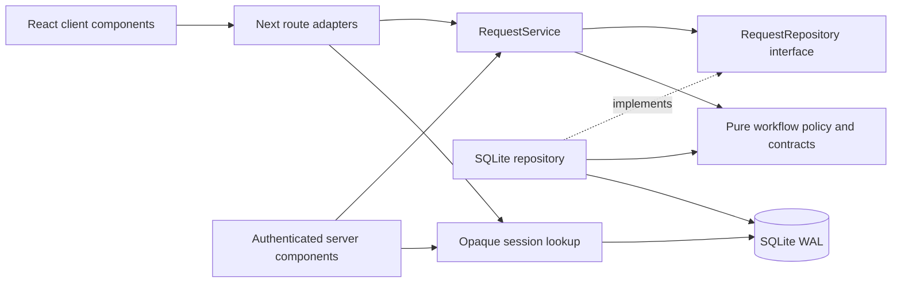
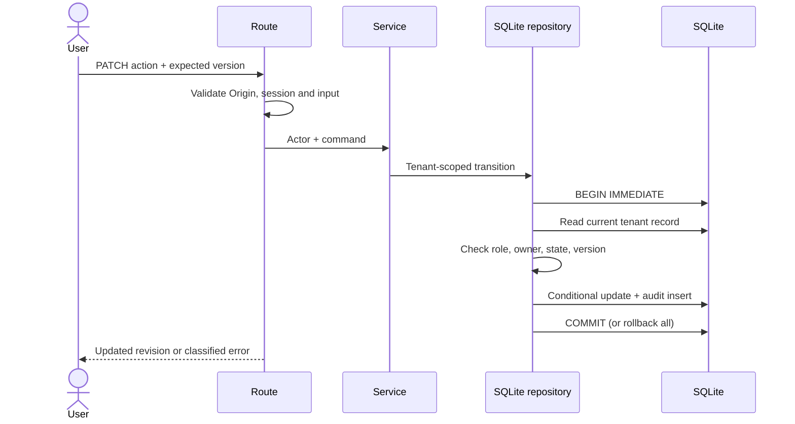
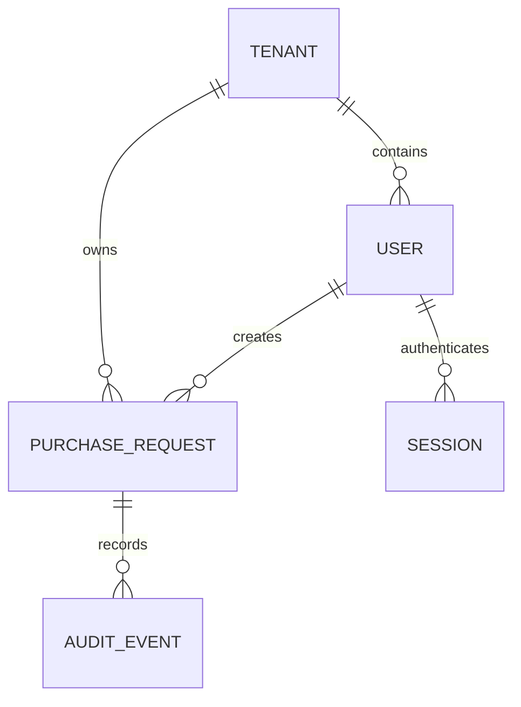

# Architecture

## A coherent procurement boundary

The business problem is deciding a purchase with a recorded owner, amount, revision and independent reviewer. A request belongs to one tenant and moves from draft to pending, then approved or rejected. Approved/rejected records are terminal. Requesters may submit only their own drafts. Approvers may create requests but cannot decide their own. Viewers never mutate.

`src/features/requests/domain` defines plain data types, input contracts and pure transition policy. `application` exposes RequestService and a consumer-owned RequestRepository port. `infrastructure/sqlite-repository.ts` implements the port using parameterized SQL. Next route handlers translate authentication, HTTP errors and request bodies. Presentation components render data and collect intent; they never decide authorization.

`src/infrastructure/container.ts` is the composition root. Its process-global database handle belongs only to infrastructure. It stores no current actor or tenant; each request resolves an actor from its own session and passes it explicitly. Dashboard data is computed on the server per tenant. Authenticated routes are dynamic and API responses use no-store. No cross-request user response cache is used.

`TanStack Query` owns browser server-state caching. Search/status/page are part of the key. Forms use React Hook Form and Zod; amount strings become integer minor units without floating-point multiplication. The domain schema enforces positive, bounded integers independently of the browser. A missing repository record is always 404 inside the caller's tenant scope.

## Dependencies

## Transaction boundary

A business transition and its audit event share one transaction. A database failure after the update cannot leave an unaudited decision. BEGIN IMMEDIATE serializes writers; the conditional version predicate also expresses and enforces the application conflict contract. A stale browser gets 409 and must refresh, rather than silently overwriting another decision.

## SOLID applied

| Principle             | Concrete implementation                                                                                                           |
| --------------------- | --------------------------------------------------------------------------------------------------------------------------------- |
| Single responsibility | policy owns workflow; service owns orchestration; repository owns transactions; route owns HTTP                                   |
| Open/closed           | a new persistence adapter can satisfy RequestRepository without changing workflow policy                                          |
| Liskov substitution   | the port describes tenant-scoped, atomic operations; an adapter must preserve conflict and audit semantics, not merely signatures |
| Interface segregation | RequestRepository serves the purchase use cases; identity is a separate service, not a universal repository                       |
| Dependency inversion  | application imports the repository interface, composition injects SQLite; domain imports no Next/SQLite/React                     |

No base-controller inheritance, universal CRUD service, service locator in domain code or redundant state library was added. Components are split by user task; formatting, API transport and status display are shared.

## Data and scaling

Indexes scope request listings by tenant/status/date and audit lookup by tenant/request. Pagination caps at 50 records per request. Search uses parameterized LIKE with escaped wildcard characters. SQLite WAL is a practical single-node default, not a distributed database claim. A PostgreSQL adapter must retain the port's transactions, tenant filters and optimistic revision predicates. Multi-node deployment additionally needs shared session storage and a migration runner.
